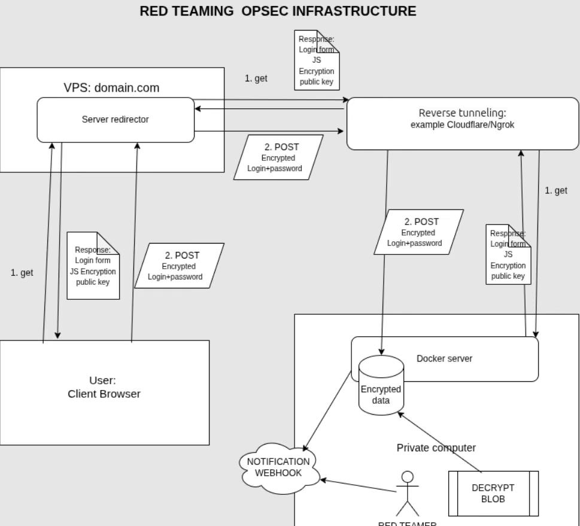

# Adversary_simulation_lab
Red and blue team simulation lab for security awareness and blue team detection testing

This repository represents infrastructure lab for red team exercises and educational purposes.
Do not use for malicious purposes.

Core concept is build around idea borrowed from [bluescreenofjeff's red-team-infrastructure-wiki](https://github.com/bluscreenofjeff/red-team-infrastructure-wiki#using-redirectors).
Idea is to use redirectors to hide real target tunnel to forward traffic to redirector on VPS.
In case of any problem in hosting on VPS, for example burning down a server because of reporting with this infrastructure, it's easy to continue red teaming testing on different provider without burning down whole infrastructure.
Thanks to the redirector we do not store anything malicious on VPS.
Also this scenario encourages to provide e2e asymmetric encryption between user browser and red teamer machine.

## Steps to use

1. Launch cloudflare tunnel: `cloudflared tunnel --url http://0.0.0.0:8664`
2. Replace `$TUNNEL_URL` and `$MY_DOMAIN` with actual values in php files in redirector
3. Launch docker compose with captive portal
4. Move redirector files on vps machine
